# Architecture and event lifecycle

The system was qualified as a local synthetic-only research demonstrator. Its central rule is that each signal uses completed-bar information and can affect execution only at the next listed session's open.

```mermaid
flowchart LR
  A[Registered synthetic daily bars] --> B[Fail-closed provenance and OHLCV checks]
  B --> C[Completed-close SMA20/SMA50 decision]
  C -->|Order intent after close| D[Next listed session open]
  D --> E[backtesting.py 0.6.6 order, trade and position events]
  E --> F[Independent Decimal cash, share and fee ledger]
  F --> G[No-trade and buy-and-hold controls]
  G --> H[Canonical outputs and content hashes]
  H --> I[Offline process/network controls]
  I --> J[Independent report and event reconciliation]
```

## Lifecycle contract

1. Validate the registered synthetic instrument and daily-bar bytes before strategy evaluation.
2. Compute SMA20 and SMA50 from completed daily closes. The signal callback cannot see later rows.
3. Emit an order intent after the decision close.
4. Resolve the eligible fill at the next listed session's open. No decision-close fill is allowed.
5. Record the upstream framework's order/trade/position events.
6. Reconcile actual fills through an external Decimal cash/share/fee ledger and mark holdings at raw closes.
7. Compare the strategy with controls over the frozen interval, serialize canonical evidence, and independently check saved events and checkpoints.

The fixed model is long-or-cash with integer quantities and no automatic final liquidation. Commission and spread in the upstream framework were set to zero; the separately labeled Decimal ledger applied the frozen cost cases once. This is not a brokerage execution model, full accounting system, or liquidity simulator.

## Offline boundary

Recorded evaluation children ran under a macOS network-denial policy with a scrubbed environment. Local TCP negative controls were expected to fail with `EPERM`; the application reported no network attempts or initialized clients. These controls describe the audited local execution path only. They do not establish general security against arbitrary code or behavior on other operating systems.

## Framework integration

`backtesting.py==0.6.6` supplies the observed order, trade, and position path. The project integrates it in-process. The public portfolio intentionally excludes implementation details and package code. The legal classification of the runnable integration remains unresolved; see the licensing note in the [README](../README.md).
